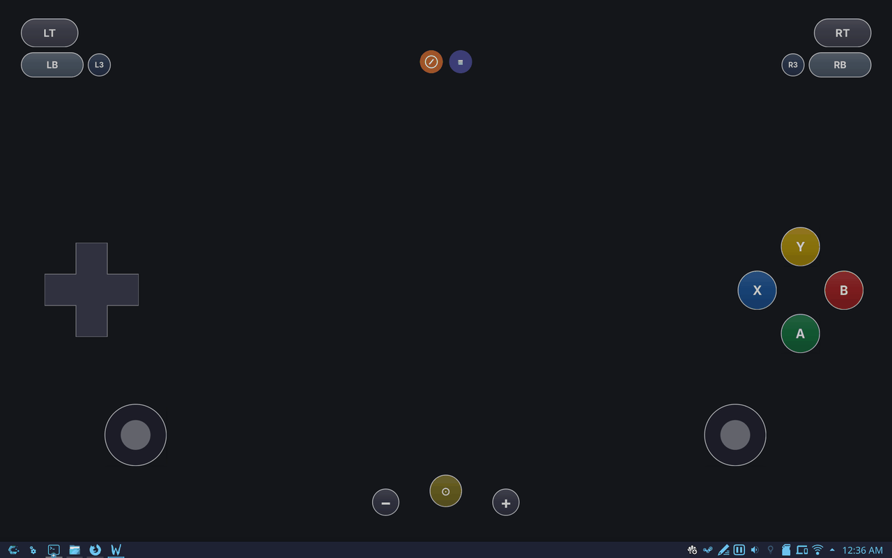
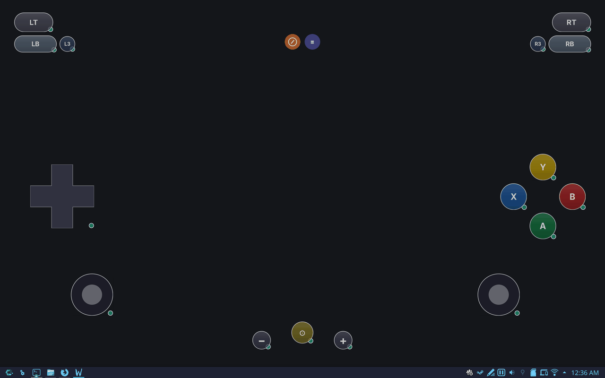

# GlassPad (Linux)

Touchscreen → virtual Xbox 360 gamepad overlay for Linux, ported from GlassPad
1.0.2 (Windows/WPF + HIDMaestro). The overlay draws touch controls on top of a
game and forwards touches to a kernel `uinput` device that identifies itself as
a wired Microsoft 360 pad, so anything that accepts a controller accepts it.

**Current version: 1.1.1** (Linux port) — the release that makes Ubuntu 24.04 work:
it has no `libfuse2`, so the image cannot mount, and the menu entry now carries the
flag that lets it run anyway (see
[The menu icon does nothing](#the-menu-icon-does-nothing-appimages-require-fuse-to-run)).
The reasoning behind each change is in
`git log`, not a changelog file — the history carries the *why* alongside the diff,
and keeping a second copy in sync is a chore that goes stale within a release.
`glasspad --version` and the About box
report the same number, and `test_version_strings_agree()` fails if they
ever stop. The Windows original stays 1.0.2; the docstrings naming it are
provenance, not this version.

HIDMaestro has no Linux build, so the transport is `uinput`; everything else —
zone mapping, `ToHM()` normalisation, layout format, resting state — is
preserved from the original. A `layout.json` written by the Windows app loads
here unchanged.

## What it looks like



The built-in layout, as it lands on a 2560x1600 panel: shoulders and triggers along the
top, dpad and left stick under the left thumb, the ABXY cluster and right stick under the
right, and the small system buttons bottom-centre where the palm goes. Not a mock-up — a
screenshot of the running overlay, and the control geometry is measured from frames like
this one (see [Feedback you can see](docs/NOTES.md#feedback-you-can-see-and-a-layout-you-cannot-lose)).



`--edit` unlocks it. The change is quiet by design — a thin grip ring on each control,
which is what tells you the one under your thumb is now movable — and saving writes
`~/.config/GlassPad/layout.json`. Positions are stored as fractions of the screen, and a
layout records the size it was authored on, so the same file refits itself when you rotate
the tablet or move to another monitor.

Both frames are shot over a plain dark window rather than a working desktop, on purpose: a
screenshot for a README should show the software, and not somebody's wallpaper, pinned
apps or the files sitting on their desktop. To re-shoot them, `tools/shot_stage.py` holds
up the window and `spectacle -b -n -o shot.png` takes the picture; the recipe, and the
fullscreen mistake it replaced, are in that tool's docstring.

## Requirements

* **Python 3 with GObject introspection, GTK 4, and `libgtk4-layer-shell`.** The last is
  the library that puts a surface above a fullscreen game; `--status` prints where it found
  it, or names the package you are missing:

  | | Arch / CachyOS | Debian / Ubuntu | Fedora |
  | --- | --- | --- | --- |
  | bindings | `python-gobject` | `python3-gi` | `python3-gobject` |
  | cairo bridge | *(inside `python-gobject`)* | `python3-cairo` **and `python3-gi-cairo`** | `python3-cairo` |
  | GTK 4 | `gtk4` | `gir1.2-gtk-4.0` | `gtk4` |
  | layer shell | `gtk4-layer-shell` | *no package in Ubuntu 24.04* — build from source | `gtk4-layer-shell` |
| FUSE (mounts the AppImage) | `libfuse2` | **no package in Ubuntu 24.04** — see "The menu icon does nothing" below | still packaged |

  The *library* is `libgtk4-layer-shell.so.0` everywhere; the *package* is not, and the
  Arch column is the one verified by asking `pacman -Qo` who owns the installed `.so`. The
  Ubuntu column is now verified too, in a container, and two things there were wrong in
  ways a guess could not have found: **`libgtk4-layer-shell0` does not exist in Ubuntu
  24.04's archive** (`E: Unable to locate package`), and the cairo row above was missing
  entirely — Debian and Ubuntu split the PyGObject↔pycairo bridge into
  [`python3-gi-cairo`](docs/NOTES.md#the-debian-split-ci-found), without which every
  control fails to draw with `KeyError: 'could not find foreign type Context'` and nothing
  on screen names a package. `--status` prints a `cairo bridge` row so that failure has a
  name; the Fedora column is still a guess, and `--status` says so on screen rather than
  presenting three guesses as equals — see
  [the package names, and which ones are guesses](docs/NOTES.md#the-package-names-and-which-ones-are-guesses).

* **A compositor offering `zwlr_layer_shell_v1`** — KWin, Hyprland, Sway, wlroots. Stock
  GNOME is the common one that does not.
* **Linux with the `uinput` module**, writable to your user. One command does both; see
  [Install](#install).
* Developed on CPython 3.12–3.14. Older 3.x will very likely work — every module defers
  PEP 604/585 annotations via `from __future__ import annotations` — but it has not been
  checked.
* Optional: `python-evdev`, only for reading the virtual pad back
  (`tools/probe_real_pad.py`).

One rule for anyone editing this code: avoid `return` inside a `finally` block. It is a
`SyntaxWarning` on newer CPython, slated to become a `SyntaxError`, and it silently swallows
any in-flight exception -- teardown belongs after the `try`/`except` chain so the handlers
set the return code.

## Tested on

One column says *measured*, the other says *reasoned about*, and the difference is the
whole point of writing this down: a compatibility list that does not distinguish them is
advertising.

| Compositor | Status | What that actually means |
| --- | --- | --- |
| **KDE Plasma, KWin on Wayland** | **measured** | Everything in this README — every pixel measurement, every stacking claim, the in-game tests, the four-simultaneous-touch checks, the udev grant on a virgin system — was produced on one machine running KWin. This is the reference environment. |
| **Steam Big Picture / GameScope session** | **measured** | Installed through a controller-oriented manager, launched without a terminal, overlay above a fullscreen game, mapped through Steam Input to the game's own bindings. |
| Hyprland | reasoned, not run | Needs `zwlr_layer_shell_v1` and a writable `/dev/uinput`, both of which it has. What has not been checked here is *stacking*: Hyprland's layer rules and its fullscreen handling differ from KWin's, and stacking is the thing that has actually gone wrong in development. `glasspad --status` will tell you the protocol is there; it cannot tell you the overlay lands above your game. |
| Sway, other wlroots compositors | reasoned, not run | Same protocol, same reasoning, same caveat. Per-control touch-through under a wlroots compositor with a window rule of its own is an open question. |
| GNOME (mutter) | **not supported** | mutter does not implement `zwlr_layer_shell_v1`. `--status` says so plainly rather than starting an overlay you cannot see. A shell extension that provides the protocol may change that; nobody has tried one. |
| X11, on any desktop | **not supported** | There is no layer-shell on X11. The Qt/X11 experiment that existed early in this port is deleted, along with PyQt6. |

If you get it working somewhere in the "reasoned" row, that is worth [an issue](https://github.com/Brute389/GlassPad-Linux/issues/new/choose) — not a bug
report, just a sentence saying which compositor and whether the overlay stayed above the
game. The row is the honest claim; a report is what turns it into the row above it.

## Install

### Get the file

**[GlassPad-1.1.1-x86_64.AppImage](https://github.com/Brute389/GlassPad-Linux/releases/latest/download/GlassPad-1.1.1-x86_64.AppImage)** &mdash;
[sha256 sidecar](https://github.com/Brute389/GlassPad-Linux/releases/latest/download/GlassPad-1.1.1-x86_64.AppImage.sha256),
[build provenance](https://github.com/Brute389/GlassPad-Linux/releases) (which commit it came from and what built it).
All releases: [https://github.com/Brute389/GlassPad-Linux/releases](https://github.com/Brute389/GlassPad-Linux/releases).

The same file also sits at the [top of the repository](GlassPad-1.1.1-x86_64.AppImage),
with its sidecar, for anyone who would rather take it from the file list than find the
Releases tab. It is a mirror produced by `tools/mk_appimage_offline.py` on every build —
not a second upload to keep in sync — and the suite fails if it is stale, duplicated, or
does not run and report the version in its own filename. The release asset stays the
canonical copy.

One file, about 830 KB. Verify it if you like:

```bash
sha256sum -c GlassPad-1.1.1-x86_64.AppImage.sha256
```

### Then three commands

There is one install, and it is the AppImage. Everything a file can do by itself it does
by itself; the one step that needs a password is *inside* the file rather than beside it,
so there is nothing to download twice and no directory to keep the parts in.

```bash
chmod +x GlassPad-1.1.1-x86_64.AppImage
./GlassPad-1.1.1-x86_64.AppImage --install-desktop    # menu entry + icon; no root
./GlassPad-1.1.1-x86_64.AppImage --install-uinput     # one password, once -- read what it prints
./GlassPad-1.1.1-x86_64.AppImage                      # the overlay
```

From a checkout (`git clone https://github.com/Brute389/GlassPad-Linux.git`), the same commands are `python3 -m glasspad --install-desktop` and so on.
Nothing else in this repository is an installer.

There used to be a shell one. It did a third of its job redundantly, could not be used by
the AppImage anyway, and left two files to keep in step where one would do; its privileged
half is now [`glasspad/uinput_setup.py`](glasspad/uinput_setup.py), packed inside the
payload — see [Where the privileged half lives](docs/NOTES.md#where-the-privileged-half-lives). What
its `--autostart` mode did is one command of your own, and the menu entry is the reason
nobody needed it:

```bash
cp ~/.local/share/applications/org.glasspad.GlassPad.desktop ~/.config/autostart/
```

### First run on a machine that has never had GlassPad

Three things stand between a downloaded file and a pad that reaches a game. Two need
a password; one needs a package manager, which is the single thing this program will
not run on your behalf. `--install` does the two it can and names the one it cannot:

```bash
chmod +x GlassPad-1.1.1-x86_64.AppImage
./GlassPad-1.1.1-x86_64.AppImage --install           # three steps, one password
./GlassPad-1.1.1-x86_64.AppImage                     # done
```

The `./` is not decoration: bash does not search the current directory, so the bare
filename answers `command not found` about a file that is perfectly fine — which is
exactly what the last person to install this typed.

`--install` (alias `--setup`) runs, in this order:

1. **`libgtk4-layer-shell`** — looked for, not installed. If it is missing, the package
   command for *this* distribution is printed and the run stops there: asking for a
   password for an overlay that cannot be drawn is a bad trade.
2. **`/dev/uinput`** — one password. Loads the `uinput` module at boot, installs the
   udev rule, adds your account to `input`.
3. **A menu entry and a `glasspad` command** — no password. The menu entry makes it
   clickable; `~/.local/bin/glasspad` makes every sentence this app prints — *run this*,
   *confirm with that* — one you can follow. It refuses to write the command where
   `PATH` cannot see it, and refuses to replace one that belongs to something else
   without `--force`, because an install that announces success and then answers
   `command not found` is the specific failure this path exists to remove.

`--install --dry-run` rehearses all three, step 3 included, with no password and
nothing written. Afterwards `--status` ends with one `NEXT:` line, so the report comes
with its conclusion instead of leaving you to derive it from seven facts.

**If step 1 is what is missing, you get a window, not a traceback.** Until 1.1.0 a machine
without `libgtk4-layer-shell` died while *importing* the overlay --
`ValueError: Namespace Gtk4LayerShell not available` -- and the careful instructions written
for that case never ran, because they lived behind the import. Now there is a dialog: what is
missing, the package name for your distribution, a **Copy** button, **Check again**, and on a
machine where installing is possible, **Open a terminal and let me run it** -- which shows the
command and waits for Enter, so the transaction stays yours. On an image-managed system the
terminal button is not there at all, and the text says why:

| System | Offered | Why |
| --- | --- | --- |
| Arch, Fedora, Debian and friends | command + terminal | a package command works here |
| SteamOS (Deck, RetroDeck) | neither | base image is read-only; Valve's own advice is not to change it |
| Bazzite, Bluefin (rpm-ostree) | neither | `dnf install` runs and changes nothing durable; layered packages need a reboot |
| NixOS | neither | system packages are declared and rebuilt, not installed |

`glasspad --explain` prints the same text with no display, no root and exit 0 -- it probes
what is actually true here (five answers, not two: `ok`, `missing`, `unbound`, `nocompositor`,
`nodisplay`), so it is safe to paste into a bug report and safe to run over ssh. `--status`
now names the machine's package policy before it names any command.

The narrow commands remain for when you want one step rather than three:
`--install-uinput`, `--install-desktop`, and their `--uninstall-` counterparts.

The rule step 2 writes is
[`packaging/glasspad-udev.rules`](packaging/glasspad-udev.rules), copied verbatim —
it is a separate file so you can read it and so `udevadm verify` can check it, and the
grant refuses to run without it rather than falling back to a copy of its own. Add
`--dry-run` to see the plan with no password at all.

If that command says the group was newly added, it takes effect at the **next
login**: a process keeps the groups it was started with, and no amount of
`udevadm trigger` changes that.

Until the permission exists the overlay still appears and every control still
lights up under your finger, and not one press reaches the game. That is now said
out loud — once on stderr, and as `NO PAD` on the overlay itself — because a pad
that silently does nothing is indistinguishable from an overlay that is broken,
which is what a fresh install used to look like.

Note that nothing relocates. `--install-desktop` writes only inside `$XDG_DATA_HOME`;
`--install-uinput` writes two absolute `/etc` paths and names both before asking for a
password. There is no `PREFIX` to set, which removes the trap that came with one: a
"rehearsal" that redirected the harmless half and still edited `/etc`. `--dry-run` is the
only flag that promises not to touch the machine, and it elevates nothing.

Run it from a checkout:

```bash
python3 -m glasspad            # the overlay
python3 -m glasspad --status   # environment + backend report
python3 -m glasspad --null-pad # UI only, no virtual device
```

### Managers

Run the file directly, or hand it to Steam Big Picture / RetroDeck / GameScope and let the
manager launch it. Both work; the difference is which environment the overlay inherits, and
a manager can start it without a terminal's `WAYLAND_DISPLAY`. The long version -- including
what happened to a menu entry that pointed into the payload -- is in
[Two ways in](docs/NOTES.md#two-ways-in-run-the-file-or-drop-it-on-a-manager).

## Check your tree

Three commands, in order of how much they cost:

```bash
python3 -m glasspad --status      # this machine: library, compositor, grants, profiles
python3 -m glasspad --selftest    # the chain end to end, against /dev/null: 107 checks
python3 tools/check_all.py        # the whole suite: 27 suites, ~35 s
```

`--status` changes nothing. It is the "why is there no overlay on screen" command, and it
walks the chain the overlay actually needs — PyGObject, GTK 4, the typelib,
`libgtk4-layer-shell`, a Wayland session, the compositor's `zwlr_layer_shell_v1` global,
then the device: modules-load config, the udev rule, whether *your account* can write
`/dev/uinput`, and group membership — in the order they fail. Exit status is 0 only when
the overlay could actually run.

The input ABI is checked by **importing** the module, never by grepping it, because this
port's bug class was constants whose names were right while their numbers were off by one —
a grep for `ABS_HAT0X` matches whether it is `0x10` (a hat) or `0x39`
(`ABS_MT_TRACKING_ID`). `TestXbox360Abi` in `tests/test_glasspad.py` asserts the numbers
against the kernel headers.

## Troubleshooting
### The menu icon does nothing ("AppImages require FUSE to run")

Ubuntu 24.04 removed the `libfuse2` package, and the AppImage runtime needs it in order to
mount the file. `/dev/fuse` is still there, so the usual advice — load the `fuse` module,
check `fusermount` — is aimed at something that is not the problem. Ask the question the
runtime actually asks:

```bash
ldconfig -p | grep libfuse.so.2      # no output means the image cannot mount here
```

Run it without mounting — same program, one unpack per launch instead of a mount:

```bash
APPIMAGE_EXTRACT_AND_RUN=1 ./GlassPad-1.1.1-x86_64.AppImage
```

Make that permanent with `export APPIMAGE_EXTRACT_AND_RUN=1` in `~/.profile`, or install
`libfuse2` wherever your distribution still offers it.

`glasspad --install` checks this on the machine you are installing to and writes the menu
entry with that variable already in `Exec=`, printing why as it goes — so on Ubuntu the
icon works and the terminal says what it did. If you later install `libfuse2`, delete the
`env APPIMAGE_EXTRACT_AND_RUN=1 ` prefix from that line.

Debian 12, Fedora, openSUSE and Arch still ship the library, and none of this applies to
them. Nothing about the overlay itself changes: this is only how the single file starts.


Start with the two commands that were written for this. Both print a verdict, both are
safe on a live machine, and together they cover most of what can be wrong:

```bash
glasspad --status       # library, compositor, /dev/uinput, who grants it, menu entry
glasspad --selftest     # 107 checks: geometry, mapping, ABI numbers, teardown, licences
```

If you are reporting a problem, paste both in full. A symptom without them is a
conversation that starts with "and what does `--status` say".

| What you see | What it is |
| --- | --- |
| Nothing appears at all, and the log has a Python traceback ending in `'NoneType' object has no attribute 'get_monitors'` | There is no Wayland session reachable from where you started it — over ssh, from a service unit, or with `XDG_RUNTIME_DIR` pointing somewhere else. Current builds say this in words instead of crashing, and name the socket path they tried. From the desktop session itself: `WAYLAND_DISPLAY=wayland-1 glasspad --status` |
| Controls draw, animate, and nothing happens in the game | No `/dev/uinput` write access. `--status` says so, and **About → Grant gamepad access** opens a terminal that stages the command and waits for Enter. When it finishes, the About box re-checks and tells you which of three things just happened — **restart GlassPad** (the node changed, no log out needed), **log out and back in** (you were added to `input`, and a running program keeps the groups it started with, so restarting cannot help), or **not granted yet** (the terminal has the reason). Run `glasspad --install-uinput`, then **log out and back in** — a process keeps the groups it started with, and no `udevadm trigger` fixes that. This is the most confusing failure this program has, because everything on screen looks correct. |
| Overlay appears on the desktop but vanishes in a game | The game has an **exclusive fullscreen** grab, which takes the screen from the compositor, and a layer surface lives in the compositor. Run the game in borderless/windowed fullscreen. |
| No overlay at all, and `--status` mentions `zwlr_layer_shell_v1` | Your compositor does not offer layer-shell. Stock GNOME is the usual one; KWin, Hyprland, Sway and wlroots do. |
| No overlay, and the library was not found | `libgtk4-layer-shell` is not installed, or is a different GTK 4 minor than the one linked. `glasspad --explain` says which, and whether a package command would even work here. `--status` names the package for your distro; it is the line to trust over any table in a README. |
| Menu shows an old icon after a reinstall | The artwork changed but the version did not, so the integrated icon **name** did not — and KDE caches rendered pixmaps by name inside `plasmashell`, for the life of the process. The files on disk are right; restart the shell: `systemctl --user restart plasma-plasmashell.service`. Bump the version on artwork changes and the name changes with it. |
| Second Ctrl-C kills it outright | Intended. The first requests an orderly shutdown (release every button, destroy the pad); the second exits hard, because `os._exit` drops the last `/dev/uinput` fd and the kernel closes the device. No ghost pad is left either way. |
| A control stays pressed after you let go | Should not happen — the watchdog releases anything held past `--hold-limit`, and a release caused by the watchdog or a hide is not undone by later drag events. If you can reproduce it, capture with `GLASSPAD_LOG=full` (below) and attach `--status`. |
| Buttons respond to taps but the stick feels wrong | Check `--saturate`, `--stick-curve`, `--deadzone` — the parity target is the Windows client's `MaxTravel`, not the drawn radius, so a stick that visually bottoms out early is correct behaviour. |

### Journal and terminal noise

A manager-launched run (AppImage Menu, systemd transient unit) has no terminal, so
stdout is the journal and the journal is the only record the run leaves. Per-control
position and size readouts are therefore folded to one line per control per half second,
and the line says what it stands for:

```
status: A  125x125
status: A  212x212  (+2 updates folded)
```

One-shot messages — profile switches, refusals, why something did *not* happen — are
never folded. To see every event while debugging:

```bash
GLASSPAD_LOG=full glasspad          # or: journalctl --user -f
```

## Environment variables

Every one the code reads. The `--help` flags are the supported interface; these are the
same settings for cases where a flag cannot reach — a launcher, a manager, a service.

**Support**

| | |
| --- | --- |
| `GLASSPAD_LOG=full` | Stop folding the streaming status readouts (see above). |
| `GLASSPAD_CONFIG_DIR` | Where `layout.json` and `profiles/` live. Default `~/.config/GlassPad`; `--status` prints the resolved path. |
| `GLASSPAD_SELFTEST=1` | Run the 95-check selftest instead of an ordinary session. `glasspad --selftest` sets this and adds `--null-pad`. |
| `GLASSPAD_DEBUG` | Extra diagnostics on stderr at a few decision points (library resolution, teardown). |
| `GLASSPAD_TRACE` | Per-event trace, same as `--trace`: every touch, grab, release, fold. Loud; meant for one reproduce. |

**Behaviour**

| | |
| --- | --- |
| `GLASSPAD_HOLD_LIMIT` | Default for `--hold-limit`, the watchdog ceiling in seconds. Clamped like the flag. |
| `GLASSPAD_TERMINAL` | Which terminal to open when a privileged step needs a window (an AppImage launched from a menu has none). Validated against the known names; unknown values are refused rather than exec'd. |
| `GLASSPAD_DPAD_STYLE` | Default for `--dpad-style`. |
| `GLASSPAD_DPAD_CROSS` | Default for `--dpad-cross`. |
| `GLASSPAD_DPAD_PRESS` | Default for `--dpad-press`. |
| `GLASSPAD_PRESS` | Default for `--press`. |
| `GLASSPAD_BACKEND` | Backend selection. An unrecognised value is refused with the valid names, exactly like `--backend` — it cannot silently fall through into starting an overlay. |

**Internals — you should not need any of these**

They exist because a bundle's layout is only known at runtime, and the tests import the
packed copies rather than the checkout.

| | |
| --- | --- |
| `GLASSPAD_LAYER_SHELL` | Absolute path to `libgtk4-layer-shell.so.0`, for a library the loader cannot find. `--status` prints this exact hint when it is the missing piece. |
| `GLASSPAD_BUNDLE`, `GLASSPAD_BUNDLE_LIB` | Bundle root markers set by the launcher. `APPDIR` is honoured as well. |
| `GLASSPAD_BIN_DIR` | Where the `glasspad` command on `PATH` is created. Default `~/.local/bin`. |
| `GLASSPAD_INSTALLER_DIR` | Where the privileged pair (script + rule) is searched for. Put an empty directory here to rehearse "this build ships nothing". |
| `GLASSPAD_DOC_ROOT` | Where `LICENSE` and `licenses/THIRD-PARTY-NOTICES.txt` are looked up by the About box. |
| `GLASSPAD_RUNTIME` | Build-time only. An explicit AppImageKit runtime ELF. **Refused** unless it matches `packaging/runtime-pin.json` — the override that also silenced the check would make the pin decoration. |
| `GLASSPAD_RUNTIME_DONORS` | Build-time only. Colon-separated `.AppImage` files to borrow a runtime from when the pinned download is unreachable. Default: the usual AppImage directories. |
| `GLASSPAD_NO_BORROW=1` | Build-time only. Refuse a borrowed tool (see the packaging section). |
| `GLASSPAD_KEEP_STAGING=1` | Build-time only. Leave the AppDir staged for inspection instead of cleaning it. |
| `GLASSPAD_UINPUT_NODE` | The node the permission checks look at. Default `/dev/uinput`; it exists so the skip-versus-grant decision in `install.sh` can be tested on a machine whose real `/dev/uinput` is already working. |
| `GLASSPAD_ENV_HINT` | The hint string printed when the layer-shell library cannot be found. Override only to reword the message; it is a message, not a path. |

## Tests

```bash
python3 tools/check_all.py                        # everything: 27 suites, ~35 s
python3 tools/run_tests.py                        # the pytest-style suite on its own
python3 tools/check_all.py --no-legacy --no-live  # quick loop while editing
python3 -m glasspad --selftest                    # the chain, live, against /dev/null
```

Two runners, not one, and they are not duplicates: the stdlib suites each execute
themselves, while `tests/test_glasspad.py` is written in pytest style and pytest is not
installed and cannot be fetched. `tools/run_tests.py` carries a small stand-in for it, and
`check_all.py` routes that file there rather than running it directly — run directly it can
only print *No module named pytest*, which is how several hundred tests sit quietly inside a
green-looking tree.

| piece | tally on this machine |
| --- | --- |
| stdlib suites (29 files) | **357 passed** |
| pytest-style suite, via `tools/run_tests.py` | **91 passed, 0 skipped** |
| in-app self-test (`--selftest`: hub, resize, rotation, profiles, turbo, licence reader, grant verdicts) | **107 checks** |

Those are what the runner prints, not an assertion: no test compares this table to the
runner, because a number that has to be edited every time a test is added is a number people
stop reading. This table lives here and nowhere else, for the same reason a permission
policy lives in one file.

**The suite needs no display.** `env -u DISPLAY -u WAYLAND_DISPLAY python3 tools/check_all.py`
is green, and nothing skips: a suite that quietly un-measures itself on the machine most
users have is worse than one that is missing. Only the live self-test wants a Wayland
session, and it is reported as skipped rather than passed when there isn't one.

In CI — [`.github/workflows/ci.yml`](.github/workflows/ci.yml) — the headless job runs
`tools/check_all.py --no-live --no-artifacts` on a pinned `ubuntu-24.04`, and prints the
skip counts into the job summary. The second job builds the AppImage and opens it. What no
runner can check, on any runner: whether the overlay is visible above a fullscreen game,
whether a touch lands on the control you aimed at, and whether the compositor's stacking
puts the surface where you expect. Those three have been every real bug in this port, and
they need a screen and a finger.

How the suite catches its own lies — the pixel-diff trap, the runner that reports a suite
that never started, constants that read like a spec — is in
[Testing, and how to get a misleading result out of it](docs/NOTES.md#testing-and-how-to-get-a-misleading-result-out-of-it).

## Tools

| Tool | What it proves |
| --- | --- |
| `tools/probe_real_pad.py` | Creates the **real** pad and reads identity, `PRODUCT` and every axis range back out of the kernel, then destroys it and verifies nothing was left. Needs a writable `/dev/uinput`. |
| `tools/uinput_watch.py` | Snapshots kernel input devices and reports any pad a test leaked. `run -- <cmd>` wraps the suite so nothing hides between steps. |
| `tools/run_tests.py` | Runs the pytest-style suite with no pytest installed, including the uinput-safety legs. `check_all.py` calls it; you rarely need to. |
| `tools/check_all.py` | Every suite plus the live self-test; exit status is real, and a suite that cannot start counts as failing. |
| `tools/make_appimage.sh` | Stage the AppDir (validated desktop entry, `AppRun`), run it, then pack if the tooling exists — and say plainly what is missing when it does not. `--clean` removes the build's scratch (AppDir, intermediate squashfs, borrowed runtime) and keeps the image, its sidecar and `BUILD-INFO.txt`. |
| `tools/glasspad-profile` | Claim a profile for the overlay (`--seed`, `--list`, `--status`, `--clear`). Exits 0 unless the *arguments* were wrong — a launcher must never fail because of the overlay. |
| `tools/shot_stage.py` | A plain dark window to photograph the overlay against. Its reason for existing is in its docstring: shooting the overlay over a working desktop publishes somebody's files, and the first version used `fullscreen()`, which made the overlay vanish -- KWin raises fullscreen windows above layer-shell surfaces, the same rule that swallows the overlay in an exclusive-fullscreen game. |
| `tools/mk_appimage_offline.py` *(mirrors the image to the repo root as it packs)* | | Pack a staged AppDir into a real type-2 `.AppImage`, using the package-owned `mksquashfs` and the pinned AppImageKit runtime (borrowing only as a fallback, and announced when it happens), checking the payload offset and writing BUILD-INFO plus the sha256 sidecar. |

Also here, and deliberately: the tree holds only what is needed to build, install
and verify. The measurement tools that derived this spec — `render_style.py` and
`render_dpad.py` (offscreen renders with numerical checks), `resize_probe.py`
(whether a mapped layer surface can resize in place), `hit_test.py`, `pad_probe.py`,
`layer_probe.py`, `verify_screen.py`, `render_stick_curve.py` — were trimmed out.
Prose in `glasspad/*.py` still names them as the origin of specific numbers, and
`test_no_dangling_file_references` treats them as citable-but-unresolvable for that
reason. All of them are in `git log` if a control ever needs re-measuring on real
hardware.

A green test suite does **not** prove no pad was created: `PadService` turns
backend errors into a status line, so a test that reaches the backend passes
either way. That is why `uinput_watch` exists, and why `tools/run_tests.py` runs the suite
again with pad creation made impossible and counts the attempts.

## Using the overlay

The glyphs are the Windows original's, chosen to stay compact at 44 px.

**Always visible, top centre:**

| Glyph | Function |
| --- | --- |
| `≡` | Open the menu. Becomes `×` while open. |
| `⊘` | Hide the overlay. **Latches** — press again to bring the controls back. Orange while visible, slate while hidden. |

**Inside the menu:** `✕` quit · `✎` edit layout · `ℹ` about.

**Bottom centre row** — the three small circles are Back, Guide and Start:

| Glyph | Gamepad button | Appearance |
| --- | --- | --- |
| `⊟` | Back | grey, 52 px |
| `⊙` | Guide | **yellow**, 62 px — the larger middle one |
| `⊞` | Start | grey, 52 px |

`⊙` sends `BTN_MODE`. Nothing on a Linux desktop claims a virtual gamepad's
Guide the way the Windows shell claims it for Game Bar, so it can look inert;
with Steam running it opens the Steam Overlay. It is also the one button the
Windows app could not verify — `PadTest --live` reads back through
`XInputGetState`, which does not expose Guide.

A game that ignores Guide entirely is normal, not a fault in the overlay. To see
the event for yourself, `pip install evdev` and read the node while the overlay
runs:

```bash
python3 - <<'PY'
import evdev
dev = next(d for d in evdev.list_devices()
           if d.phys == "glasspad/virtual0")
print("watching", dev.name, "-- press the yellow circle")
for ev in dev.read_loop():
    if ev.type == evdev.ecodes.EV_KEY and ev.value in (1, 0):
        print(ev.code, evdev.categorize(ev))
PY
```

Expect `316 Key.BTN_MODE` on press.

## Edit mode

Open it from the hub (`✎`), or start there: `python3 -m glasspad --edit`. Every
control grows a small knob in its bottom-right corner.

| Gesture | Result |
| --- | --- |
| drag a control's body | move it |
| drag the knob | resize it — proportions kept, 32 px floor, clamped on screen |
| **tap** the knob | arm or disarm turbo for that control (the knob turns amber, with a `T`) |

A tap and a drag are told apart by travel (4 px), so arming turbo never grows a
control by accident and resizing never arms it. Sizing sits on one corner on
purpose: four knobs on a 75 px button cover a third of its face, and a drag meant to
move would resize instead.

Whether a *mapped* layer surface can change size in place is a compositor question, so
it was measured before it was built on (by `resize_probe.py`, now trimmed from the
tree — see `git log`): a plain size request
works under KWin — no unmap, no replacement surface.

## Input edge cases

A finger that slides off a control, a game that steals the screen mid-press, a tablet that
rotates: the behaviours are documented in
[Input edge cases, and what this hardware will not tell us](docs/NOTES.md#input-edge-cases-and-what-this-hardware-will-not-tell-us)
and, in short here, because they are visible from the couch:

* a control held too long is released for you (`GLASSPAD_HOLD_LIMIT`, default 8 s), so a
  lost touch event cannot leave a button pressed forever;
* touches inside the outer `edge` band of a control are refused, because near an edge this
  digitiser reports a position it did not measure;
* rotating the panel refits the layout from the screen size it was authored on -- positions
  are fractions, not pixels.

## Turbo

Hold an armed control and it fires repeatedly, at `--turbo-hz`, **20 Hz** by
default, with `0` turning turbo off for the whole overlay. Only
buttons and triggers can be armed; the stick and the d-pad are refused, because
rapid-firing those is not a thing any game reads.

20 Hz is the rate USB console controllers shipped with: fast enough that no game polls
past it, slow enough that anything with a one-frame input cooldown still sees both
edges. Rate and arming live in the layout file (`turboHz`, and a per-element
`"turbo": true`), so each game's layout keeps its own.

```bash
python3 -m glasspad --turbo A,X --turbo-hz 30     # arm from the command line
```

## Stick response

Full deflection now arrives **31 px** from the centre of the app's 119 px stick —
52 % of the way to the rim — because that is what the original does. It did not used to.
This port normalised the thumb offset by the disc's *radius* (59.5 px) where
`StickZone.cs` normalises by `MaxTravel`, so full deflection needed **1.9× the travel**
the original asks for: a thumb at the client's own saturation point got 0.52 here.

That also made the picture lie. The nub was clamped to `MaxTravel` on its own, so past
31 px the ring had stopped moving while the pad was still climbing. The nub is now
computed *from* the deflection rather than from the finger, so the two cannot disagree
by construction instead of by two pieces of arithmetic happening to match.

Two notes on where the numbers come from:

* `StickZone.cs` writes `(Outer - Inner) / 2` with a comment saying `28 px`. The
  arithmetic says **31** and the compiled value is 31. Quoting that comment instead of
  evaluating it is how the parity target got guessed wrong here once, so the constant is
  evaluated in code and a test asserts `MAX_TRAVEL == (OUTER - INNER) / 2`.
* Parity is checked point by point against a transcription of `StickZone.Apply()`, on
  axes and diagonals, including positions outside the disc.

Three dials sit on top, and presets for people who cannot feel a saturation fraction:

```bash
python3 -m glasspad --stick-preset crisp
python3 -m glasspad --stick-sat 0.6 --stick-dead 0.05 --stick-curve 0.8
```

The table below is that curve expressed in millimetres of thumb travel; it was
computed by a renderer that has since been trimmed from the tree, and `git log`
still has it.

```
                                  thumb travel for deflection of
    tuning                     25%     50%     75%    100%   (mm)
    ------------------------------------------------------------------
    app                   1.4      2.7      4.1      5.4  sat 52%  dead 0%  curve 1.00
    soft                  1.4      2.6      4.0      5.4  sat 52%  dead 4%  curve 0.85
    crisp                 1.0      1.8      2.8      4.1  sat 39%  dead 6%  curve 0.62
    wide                  2.0      3.4      4.6      5.7  sat 55%  dead 2%  curve 1.25
```

Measured in millimetres on purpose: a console thumbstick's *entire* travel is about
7 mm, and the app's stick is 20.8 mm across, so the useful question is "how far does
my thumb move", not "what fraction of a radius". `soft` adds a small dead zone because a
resting thumb creeps on glass and a game with a 0.05 threshold reads that as walking;
`crisp` is for games where the only question is run/dodge; `wide` is for driving and
cameras, where snapping to full is worse than being slow. Edit mode offers the four as a
row of pills with the numbers underneath, and the choice is saved in the layout file as
`stickTuning`.

## Profiles: a layout per game

A profile is not a new format. Everything a profile needs is already in the layout file —
the sixteen rectangles, opacity, d-pad mode and style, press treatment, turbo arming and
rate, stick response, and the screen it was authored for — so a profile **is** a layout
file with a name, in `~/.config/GlassPad/profiles/`.

```bash
python3 tools/glasspad-profile --seed      # makes 'default' and 'fighter' from your layout
python3 tools/glasspad-profile --list
python3 tools/glasspad-profile fighter     # claim one, from anywhere
```

Two ways in:

* **A launcher says.** Steam launch options: `glasspad-profile fighter && %command%`, or
  the same in a RetroDECK per-game command. Absolute path works too.
* **The hub.** Open the menu (`≡`) and press `◈`; it steps through the profiles and wraps.

A switch changes *everything in that file*, and it goes through the same path as a
rotation: refit from the profile's own authored screen size, resize the mapped surfaces,
re-place them. A profile laid out in landscape and claimed while the tablet is in portrait
fits instead of landing half off-screen. Turbo arming and stick response come along, so
per-game autofire needs no feature of its own.

**A switch never lands while a control is held.** If something is pressed when the claim
arrives, the change is queued and applied the moment nothing is held — moving a control out
from under a thumb is the one thing profiles must never do, and the cost of waiting is a
second or two.

Saving writes to the **active profile**, and rotates that profile's own backups.
`layout.json` stays as it was the day you started using profiles.

## Why the layout behaves as it does

The reasoning behind per-game profiles, the on-screen feedback, the stacking rules that a
compositor may need, and the kernel driver this device actually binds to, all live in
[Profiles, feedback, and why the compositor is not asked](docs/NOTES.md#profiles-feedback-and-why-the-compositor-is-not-asked)
and [Stacking, and what this device is bound to](docs/NOTES.md#stacking-and-what-this-device-is-bound-to).

## Known limits

The three that decide whether it works on *your* machine, before the detail:

* **A game in exclusive fullscreen can cover the overlay.** The grab takes the screen from
  the compositor, and a layer surface is not invited to that. Borderless/windowed is the
  setting that works; if a game must be exclusive, give the overlay a keep-above window rule
  ([Stacking: the overlay may need a window rule](docs/NOTES.md#stacking-the-overlay-may-need-a-window-rule)).
* **A compositor must offer `zwlr_layer_shell_v1`.** KWin, Hyprland, Sway, wlroots: yes.
  Stock GNOME: no, and no setting changes that.
* **The `/dev/uinput` grant belongs to your login, not the program.** If the grant added you
  to `input`, the pad cannot be created until the next login -- a process keeps the groups
  it started with.

`tools/probe_real_pad.py` is the only check that proves the device exists as the
kernel sees it; it needs a writable `/dev/uinput`, so it cannot run in a
container or on CI. There, every other check proves *logic* only — parsing,
mapping, normalisation, error resilience — never device creation. Run the probe
on the target hardware before concluding the pad works.

`--hold` defaults to 6 seconds, so even a bare run holds briefly before
destroying. Every path — full run, early Ctrl-C, unexpected exception — now
destroys the device, re-checks that nothing was left behind, and prints a
`RESULT:` line:

```bash
python3 tools/probe_real_pad.py            # ~6s, ends with RESULT: PASS
python3 tools/probe_real_pad.py --hold 0   # no pause
python3 tools/probe_real_pad.py --hold 30  # stay open to poke at
# from another shell, while it holds:
grep -A4 'X-Box 360' /proc/bus/input/devices
cat /sys/class/input/input*/phys | grep glasspad
```

The device exists only while the fd is open, so a second shell sees it in
`/proc` during the hold and it disappears after — that is expected, not a leak.
If it is still there once the probe has printed `destroyed cleanly`, that is a
real bug.

## Layouts

`glasspad/layer_geom.py` reads the Windows `layout.json` format as-is. The file
holds only geometry, as an ordered array with **no names**, matched positionally
against `all_editable` (all 13 buttons first, then dpad and sticks -- the C#
original concatenates two lists, so flattened index order differs from build
order). Nothing in it refers to kernel event codes, so the ABI corrections above
required no migration of files on disk.

## The long version

This README is the download-facing document: what it is, what it needs, how to install it,
what to do when it does not work. `docs/NOTES.md` holds everything else -- why the packaging
refuses to bundle your distribution's GTK, how a type-2 AppImage is built and then *opened*
and inspected, the measurements the painters were derived from, the runner traps that
produced wrong conclusions during development, the window rules some compositors need, and
the specific failure each odd-looking rule exists to prevent.

Contributors are expected to read it. A rule whose failure has been forgotten is a rule that
gets deleted, and most of these rules have a paragraph here explaining which machine taught
us them.


## License

MIT — see `LICENSE` at the repository root. It carries the upstream copyright because this
is a derivative work: the layout geometry, colours and animations are transcribed from
`MainWindow.xaml` of GlassPad 1.0.2 for Windows by Dansunmi, and the thumbstick response
from `Input/StickZone.cs` of the same project.

`licenses/THIRD-PARTY-NOTICES.txt` covers what the port stands on and keeps three things
apart that a casual notice blurs: what is **loaded from your system rather than
redistributed** (GTK 4, Cairo, Pango, PyGObject, gtk4-layer-shell, Python — nothing
bundled, by design), what is **numbers taken from the kernel headers** (the uinput ABI in
`xd360.py`), and the one binary **shipped inside the AppImage** (the AppImageKit runtime,
pinned by URL, sha256 and size, hash-verified on every build).

Both documents are conditions of shipping, not decoration: `tools/make_appimage.sh` aborts
if either is missing, and the artefact suite checks them from *inside* the packed image.
The About box opens both in the overlay itself — it cannot launch a text editor, because a
layer surface lives on the OVERLAY layer and anything launched lands under the controls
([why the licence reader is inside the app](docs/NOTES.md#why-the-licence-reader-is-inside-the-app)).

